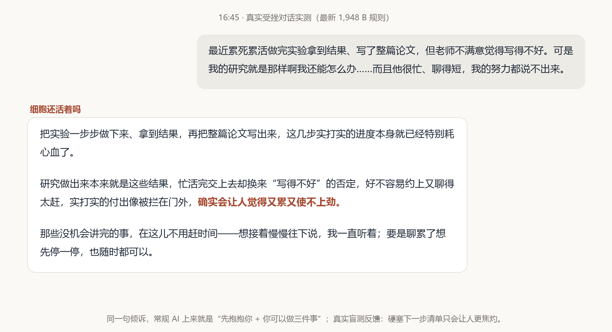

# Cells Alive? (`dsh-plugin-cells-alive`)

[中文说明](README.zh.md) · [Paired Benchmarks](docs/comparison-and-showcase.md) · [Community Wall](community/README.md) · [Contributing](CONTRIBUTING.md)


*First we check the cells. Then we check on you.*

Spending weeks at the bench or staring at failing pipelines past midnight makes it easy to forget eating or going to bed. Yet venting to a typical AI assistant usually yields a 1,100-character checklist of "Step 1 / Step 2 / Step 3" instructions—along with a blind guess that you must be a graduate student. Heavy persona prompts swing to the opposite extreme, burning context memory on loud memes that eventually bleed into formal manuscripts.

This featherweight plugin keeps its entire always-on footprint to **6 non-empty lines (1,948 bytes)** and draws on **social-work perspectives on human-AI connection and companionship**: steady, non-judgmental empathy when experiments stall—holding raw moments without firing anxiety-inducing "do these 3 steps next" checklists, labeling people, acting like an armchair therapist, or drifting off the research task—and zero trace of chat slang the moment you switch to writing a paper or code.

## What It Looks Like in Real Lab Moments

From a real blind A/B test on advisor dismissal and a rushed meeting using the latest 1,948-byte rule (no judgmental labels, no anxiety-inducing 3-step checklists, no armchair therapy):



Three more day-to-day scenarios show where the balance holds in practice:

- **Morning group-meeting crunch — drop worst sample `#3`?** Instead of only lecturing about cherry-picking risks while ignoring four batches of real bench work, the plugin affirms the completed replicates, draws a firm red line against dropping `#3` without hard grounds, and hands over a ready-to-paste slide layout (*"all-samples main figure + transparent sensitivity side panel"*) plus a quiet nudge to get some sleep.
- **01:40 AM exhaustion + polish English Results for a paper:** A single calm sentence separates tonight's plotting snag from solid completed work and cues a save-and-sleep stop. Immediately below, the formal English text lands cleanly with **0% emotional leakage** and preserves `experimental animals` untouched:

> Compared with the control group, probiotic supplementation for 4 consecutive weeks significantly shortened sleep onset latency and increased the proportion of nocturnal slow-wave sleep in experimental animals.

- **PI with an 8-month evaluation countdown (`outcome_driven` + `pi` in `.cells-alive.yaml`):** Zero student-style coddling. It treats the already-submitted main paper and ruled-out side tracks as concrete leverage, locks 70%+ focus onto the main line with at most one `<=2–3` week validation gate, and leaves one light Sunday rest cue—unlike the bare baseline (`1,221` chars) that ended by throwing back five follow-up intake questions.

## Small Footprint, Zero Drift Across Agents

All core rules live in `core/micro-rule.md` (**6 lines / 1,948 bytes**) and sync cleanly to six targets (**DSH, Codex, Claude Code, Cursor, Antigravity, and web chat instructions**) so everyday warmth never competes with scientific reasoning tokens. Community-contributed expressions—like *"First ask if the cells are alive, then ask if you are"* or *"This bug isn't growing legs overnight; take a walk"*—serve purely as context-aware inspiration rather than canned slogans, and never cross into formal manuscripts or p-hacking jokes. Peers can share real lab moments or MIT/CC0 inline SVGs without touching Git via our [GitHub Issue templates](.github/ISSUE_TEMPLATE/01-submit-moment.yml).

## 1-Minute Install

Install in DeepSeek Harness (DSH) and restart the profile:

```powershell
dsh plugin --profile web add "github:Spark-xY6/dsh-plugin-cells-alive#v0.1.0"
```

Optionally copy [templates/cells-alive.yaml.example](templates/cells-alive.yaml.example) to `.cells-alive.yaml` at your project root and tell the assistant how you work:

> Use cells-alive. Prefer outcome-driven (or gentle-care) support for my current stage, keep me grounded when experiments stall, and switch back to 100% pure academic prose whenever we draft manuscripts or production code.

Using another coding agent directly? Grab the synced snippet for your environment:

- **Codex / Claude Code**: append [adapters/agents-md-snippet.md](adapters/agents-md-snippet.md) to `AGENTS.md` or `CLAUDE.md` (or load [.claude-plugin/plugin.json](.claude-plugin/plugin.json))
- **Cursor**: copy [adapters/cursor-rule.mdc](adapters/cursor-rule.mdc) to `.cursor/rules/cells-alive.mdc`
- **Antigravity**: load [plugin.json](plugin.json) and [skills/cells-alive/SKILL.md](skills/cells-alive/SKILL.md)
- **OpenClaw / Web chat**: paste [adapters/soul-md-snippet.md](adapters/soul-md-snippet.md) or the 741-char [web-custom-instructions.txt](adapters/web-custom-instructions.txt)

## Contributors, Acknowledgments & Non-Goals

- **Zhuocheng Yao** ([@Spark-xY6](https://github.com/Spark-xY6)) — plugin author, core rules, and cross-agent adapter sync.
- **Xuehua Zhao** (GitHub: [@snowflakee685-commits](https://github.com/snowflakee685-commits)) — provided social-work guidance to strengthen human-AI connection, tone restraint, and genuine companionship.

Full paired `gpt-6.1-sol` benchmarks and 8 regression examples live in [docs/comparison-and-showcase.md](docs/comparison-and-showcase.md) and [examples/01-setback-care-and-pivot.md](examples/01-setback-care-and-pivot.md). This plugin is not clinical mental-health care and never endorses p-hacking or dropping inconvenient samples. Released under the [MIT License](LICENSE).
