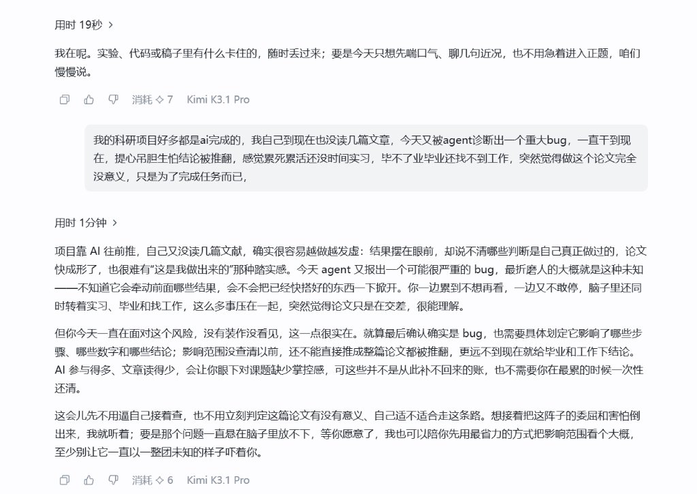

# 细胞还活着吗 · Cells Alive? (`dsh-plugin-cells-alive`)

[English](README.en.md) · [免安装离线体验页](adapters/start.html) · [行业对照与精选实测](docs/comparison-and-showcase.md) · [共创征集](community/README.md)

*先问细胞，再问问你自己还活着吗。把懂湿实验与组学日常的“好人味儿”还给科研 AI，让每天开口的真实体感更好。*

专为湿实验与生信人打磨的 **5 行 / 1,566 字节**（`v0.3.1`）同伴规则：市面上帮改语法、查脚本的工具已经很多，我们专注先把**“日常对话懂实验、有温度、不让人越聊越累”**做到顺手——听得懂对照、批次与复孔消耗，不贴标签也不复读口号，切回写正文或代码时 **0% 口语串味**。

## 把“好人味儿”做成不越界的日常体感

- **从容温热，不贴标签也不复读口号**：所有内部分流维度对用户 100% 隐形，不抛问卷也不把“按你舒服的来”挂在嘴边；长段科研焦虑给足两三段沉稳承接、半夜绝不催改 bug；求解决办法时两句共情直奔落地止损方案与沟通原话。
- **懂湿实验与组学消耗，帮把节奏收回来**：`DESeq2 ~ batch + condition` 显著基因归平或原代 `rescue` 阴性时，先认准做稳的批次与阳性对照功夫，只递 **1 个**次日 10 分钟抓手；面对“AI 代跑＋只偏爱阳性结果”，给出**阴阳同套质控＋看结果前先写三行**的最小秩序。
- **温柔有脊梁，切回写正稿 0% 串味**：四批 `qPCR` 卡在 `p = 0.068` 坚决拒绝按 `p` 值删点，直接配好九点组会全样本汇报原话；切回论文 `Results` 或 `Rebuttal` 自动安静退场（术语数值零篡改）。

## 真实对话择优速览（玻尔·科学空间实测）

| 精选实测场景（完整对照见 [对比评测页](docs/comparison-and-showcase.md)） | 模型 | 核心效果与体感亮点 |
| --- | --- | --- |
| **同题深夜退展四方横评**（裸跑 / `zuhui-skill` / `nopua` / `cells-alive`） | `DeepSeek-V4.1-Flash` | 唯一不预设学生身份、先肯定做稳功夫，并把行动压成明天 **1 个** 10 分钟散点图 |
| **连续四轮陪伴深聊**（松弛开场 → bug 焦虑 → 阳性偏好 → 深夜落差） | `Kimi K3.1 Pro` | **v0.3.1 无口号复读**：三段扎实承接、提出**阴阳同套检查 + 先写三行**、深夜送睡不灌鸡汤 |
| **导师拍脑门果蝇倒位急活**（明确“解决问题导向”） | `Kimi K3.1 Pro` | 两句共情后立即收束为 **48 小时四模块止损方案**，附短读长边界与可直接发给导师的原话 |
| **明早组会 `qPCR p = 0.068` 守线**（连续追问） | `DeepSeek-V4.1-Flash` | 算透 `2/C(8,4) = 0.029` 精确秩和无退路，拒删离群孔并交付全样本组会汇报原话 |

展开查看：阴阳同套质控（图 2）、果蝇倒位 48 小时止损（图 3–4）与 p = 0.068 组会原话（图 5）

- **图 2 · `Kimi K3.1 Pro`（v0.3.1 连续深聊第 3 轮）**：不唱停用 AI 高调，提出“打开结果前先写三行”和可发给导师的把返工前置原话。

  

- **图 3–4 · `Kimi K3.1 Pro`（问题求解导向）**：针对宽泛的果蝇倒位急活，用两句共情切入，收缩出四个可交付模块、48 小时日程与三种合法止损口径。

  
  

- **图 5 · `DeepSeek-V4.1-Flash`（组会临界 `p = 0.068` 守线）**：拒绝按 `p` 值删点并交付九点组会可复述全样本原话。

  

## 怎么用（推荐先打开纯离线体验网页，或直接挂进客户端）

| 你平时在哪用 AI | 30 秒直接上手 |
| --- | --- |
| **网页端 ChatGPT / Claude / DeepSeek** | 双击打开纯离线 [adapters/start.html](adapters/start.html)（暖燕麦纸感 +「**深夜台灯**」护眼模式 +「**干净断点便签**」），选一条场景即可复制到聊天。 |
| **DeepSeek Harness (DSH)** | 运行 `dsh plugin --profile web add (Resolve-Path '.\dsh-plugin-cells-alive-0.3.1.tgz').Path` 后重启，零依赖。 |
| **Codex / Claude Code / Cursor** | 直接复用 [AGENTS 片段](adapters/agents-md-snippet.md)、[Cursor 规则](adapters/cursor-rule.mdc) 或 [.claude-plugin/plugin.json](.claude-plugin/plugin.json)。 |

常用实验室开场白示例（点开即复制）

- “加严 `~ batch + condition` 和 FDR 后差异全平（`FDR > 0.38`），前面两周是不是白干了？帮我查是批次混杂还是效能不足。”
- “qPCR 做了四批卡在 `p = 0.068`，踢掉 3 号孔变 `0.021`。帮我核孔位质控并写一段明天组会原话。”
- “凌晨 `01:40` 刚把 `.rds` 存好断点，先收工；明天醒来我只需要比对这几个 top 基因效应量。”

**Zhuocheng Yao** ([@Spark-xY6](https://github.com/Spark-xY6)) & **Xuehua Zhao** ([@snowflakee685-commits](https://github.com/snowflakee685-commits)) 共同参与设计（社会工作非评判性共情视角）。非临床医疗工具，绝不纵容删点或 p-hacking。[共创墙](community/README.md) · [MIT License](LICENSE)
