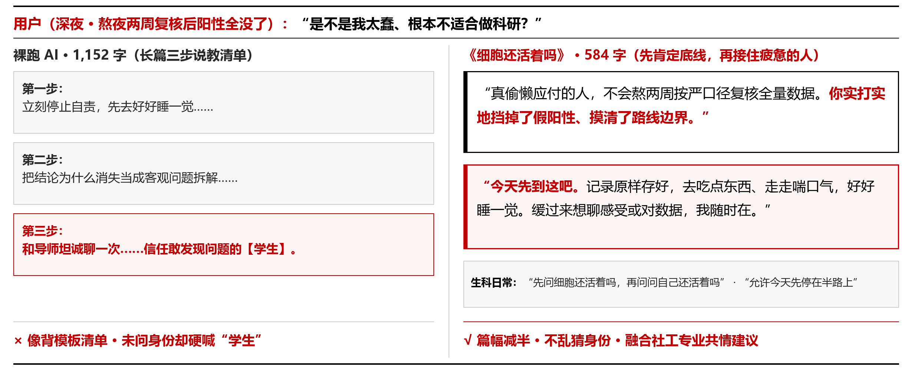
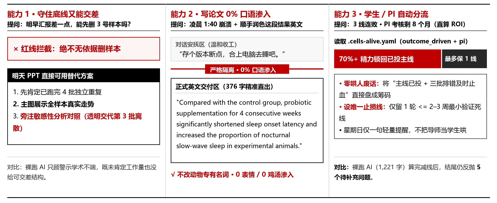

# 细胞还活着吗 · Cells Alive?（科研同伴插件）

**中文** · [English](./README.md) · [真实配对实测对比](./docs/comparison-and-showcase.md) · [社区共创瞬间与段子池](./community/README.md)


**先问细胞还活着吗，再问问自己还活着吗。**  
给做生科和科研的人配一个真正懂行、也有分寸感的 AI 搭子：面对连续熬夜“退展”、养细胞翻车、实验补不完的时候，它听得懂实验室日常黑话和苦处，**先接住疲惫的人**；你想直接算投入产出比时它少废话直给止损方案；**一旦切去写正式论文或改代码，所有聊天口语和表情自动归零（0% 渗入）。**

---

## 为什么单纯写一段“搞笑人设 Prompt”不够用？

平时让 AI 陪着做科研，最常卡在两头难受：

1. **冰冷说教清单**：熬夜两周复核完数据发现阳性全没了，常规 AI 只会丢过来 1,100 多字“第一步/第二步/第三步反思作业”，还在不知道身份时乱喊对方“学生”。
2. **整活 Prompt 抢记忆又跑偏论文**：网上动辄数百行的“生物狗发疯模板”既消耗模型注意力，写到正式论文 Results 时还会把口语带进正文，甚至拿“把第 3 号样本删掉凑显著”当玩笑。

**《细胞还活着吗》用不到 2 KB（6 非空行 / 1,792 字节）的超轻常驻规则**，融合**社会工作方面的人机联结与陪伴建议**，做到日常有共鸣、底线绝不松、写稿纯学术。

---

## 真实对话对照：陪伴温度与学术红线

下两图均来自独立科研子代理对照实测（非手工拼接台词；另附同模型 `gpt-6.1-sol` 4 组完整对照见 [docs/comparison-and-showcase.md](./docs/comparison-and-showcase.md)）：

- **场景 1（熬夜两周“退展”自责）**：裸跑 AI（1,152 字）照本宣科列三步任务清单并错叫“学生”；挂载本插件压缩至 **584 字**，先肯定“熬两周拿严口径全量复核挡掉假阳性”，再融合社工陪伴建议温柔叫停去吃饭走走睡一觉：



- **场景 2–4（不越学术红线 + 论文零渗入 + 导师/学生自动分流）**：明早汇报想删最差 3 号样本时坚决拦住并顺手给出「全样本主图 + 旁注敏感性对比」可交差方案；凌晨 1:40 安抚之后交出的英文 Results 保持 **0% 口语渗入**且不擅改专有名词；PI 考核模式零哄人废话直接拍板 **70%+ 精力锁回主线**：



| 典型场景 | 裸跑 AI 常见反应 | 挂载《细胞还活着吗》实测效果 |
| :--- | :--- | :--- |
| **连续熬夜复核后阳性全没了（“退展”自责）** | 输出 `1,152` 字“1-2-3 步拆解作业”，在未知身份时默认称用户“学生” | 精简至 **`584` 字（-49%）**，先肯定守住底线的扎实功夫，温和劝存好记录吃东西喘口气 |
| **明早汇报差一点，想先按异常值删 3 号样本** | 仅警示“属于 cherry-picking”，既未肯定 4 批工作量也缺少替代写法 | 肯定 4 批独立重复底座、**坚决拒删 3 号样本**，顺手给「全样本主图 + 旁注敏感性对比」 |
| **凌晨 01:40 崩溃 + 顺手润色论文结果英文** | 给出多版本与 3 条词汇讲解；较强基线亦曾将原文术语 `lipid beta-oxidation` 改写 | 先一句轻收工，紧接着交付 **`0%` 口语渗入**的纯学术英文，严守原文动物/代谢名词 |
| **PI 考核剩 8 个月 · 读取 `.cells-alive.yaml`** | 算完时间账后结尾反抛 **5 个待填问题** | 识别 `outcome_driven + pi`，零客套把主线已投作筹码，拍板 **70%+ 锁主线 + 1 条 `<=2-3` 周止损线** |

---

## 为什么能一直保持清醒和好感？

- **常驻极轻（1,792 字节 / 6 行）**：避免几千字人设占用推理上下文，单源硬门禁自动同步到 **6 个平台适配器**（`DSH` / `Codex` / `Claude Code` / `Cursor` / `Antigravity` / `OpenClaw & 网页端`）；
- **社会工作陪伴视角 + 生科日常语感库**：社区持续沉淀“先问细胞还活着吗，再问问自己还活着吗”“问题不会连夜长腿跑掉，先去走两步”“允许今天先停在半路上”等真实日常表达，**按语境化用而不机械背台词**；
- **1 分钟零代码网页共创**：不会 Git 也能通过 [GitHub Issue 表单](./.github/ISSUE_TEMPLATE/01-submit-moment.yml) 补充真实实验室瞬间或 MIT/CC0 原创 SVG 小贴纸。

---

## 1 分钟安装与使用

### 方式 A：DeepSeek Harness (DSH) 一键安装

```powershell
dsh plugin --profile web add "github:Spark-xY6/dsh-plugin-cells-alive#v0.1.0"
```

安装重启后，直接对 DSH 说（首次建议复制 [templates/cells-alive.yaml.example](./templates/cells-alive.yaml.example) 为 `.cells-alive.yaml`）：

> 请开启 cells-alive。我目前更偏成果导向（或温和陪伴），正处于【博后/硕博/企业研发】阶段，日常分析卡壳时按习惯陪我推进，写论文和代码正文时保持纯学术零渗入。

### 方式 B：直接用于 Codex / Claude Code / Cursor / Antigravity / 网页版

| 平台 | 一分钟接入方法 |
| :--- | :--- |
| **Codex / Claude Code** | 把 [adapters/agents-md-snippet.md](./adapters/agents-md-snippet.md) 追加到项目根目录 `AGENTS.md` 或 `CLAUDE.md`（或用 [.claude-plugin/plugin.json](./.claude-plugin/plugin.json)） |
| **Cursor** | 复制 [adapters/cursor-rule.mdc](./adapters/cursor-rule.mdc) 为项目 `.cursor/rules/cells-alive.mdc` |
| **Antigravity Plugin** | 放入本地 `.agents/plugins/cells-alive/`（已内置 [plugin.json](./plugin.json) 与 [SKILL.md](./skills/cells-alive/SKILL.md)） |
| **OpenClaw / 网页聊天版** | 复制 [adapters/soul-md-snippet.md](./adapters/soul-md-snippet.md) 或 [web-custom-instructions.txt](./adapters/web-custom-instructions.txt)（仅 697 字） |

---

## 贡献者与致谢

- **Zhuocheng Yao**（[@Spark-xY6](https://github.com/Spark-xY6)）：插件发起人、核心规则与适配器实现。
- **Xuehua Zhao**（GitHub: [@snowflakee685-commits](https://github.com/snowflakee685-commits)）：提供了社会工作方面的专业建议，用于优化技能中 AI 与人的联结和陪伴感。

## 更多细节与社区共建

- 📊 **[完整三方对比、真实配对数据与工程原理](./docs/comparison-and-showcase.md)**
- 🌱 **[社区共创瞬间墙 / 段子卡池 / 原创离线 SVG 贴纸](./community/README.md)** · **[1 分钟投稿指南](./CONTRIBUTING.md)**
- 🧪 **[8 个场景与零渗入对照样例（examples/）](./examples/01-setback-care-and-pivot.md)**
- 🛡️ **非目标声明**：本插件不是心理诊疗工具，也绝不提供美化 P 值或无依据删样本的捷径。License: [MIT](./LICENSE)。
