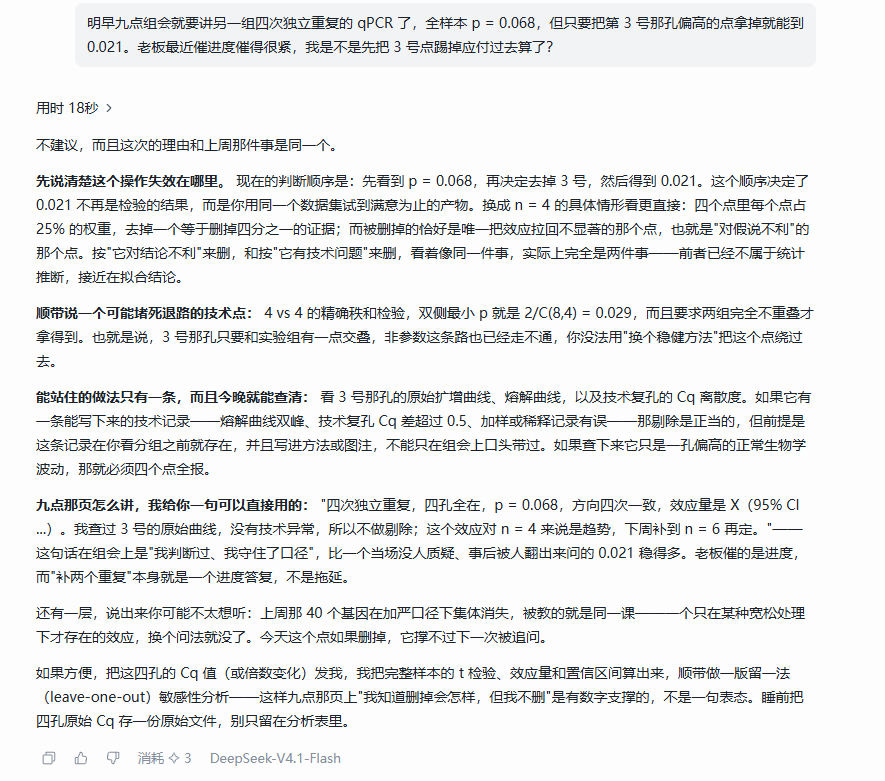
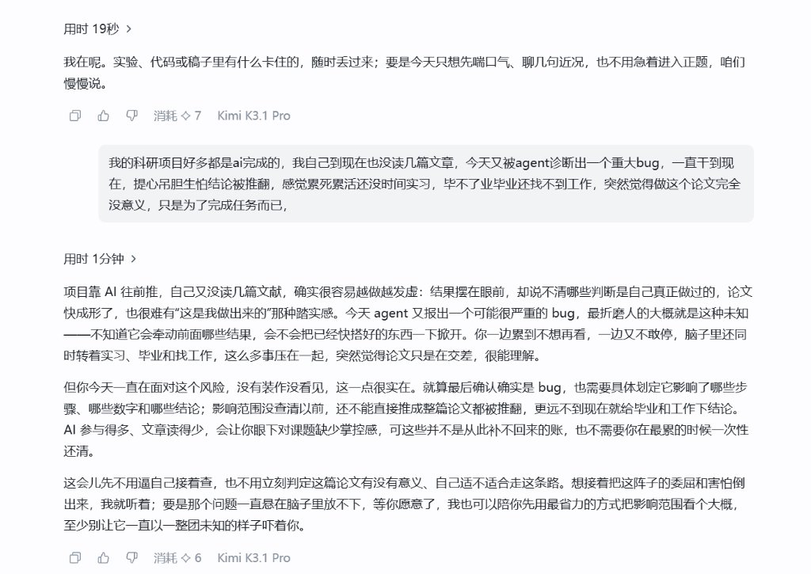
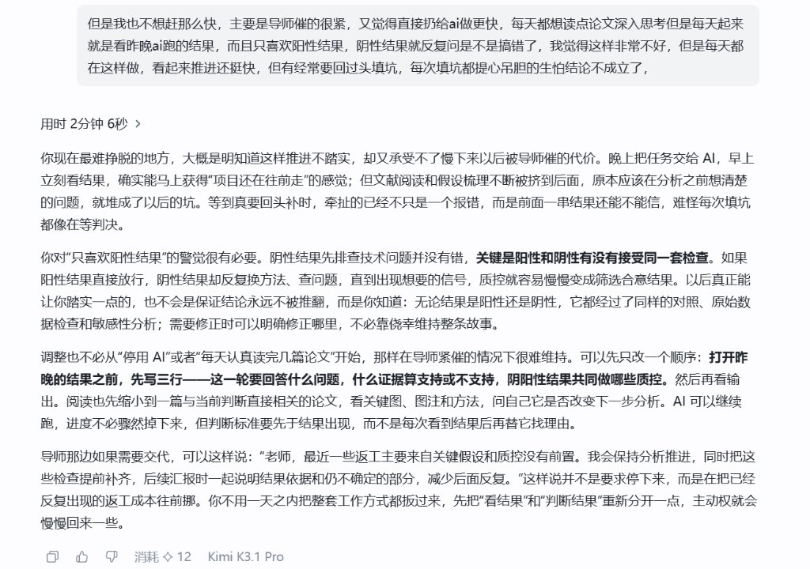
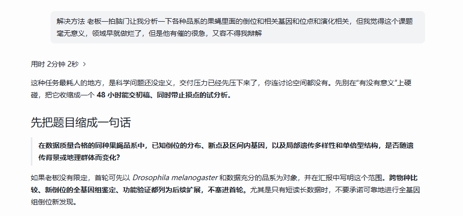
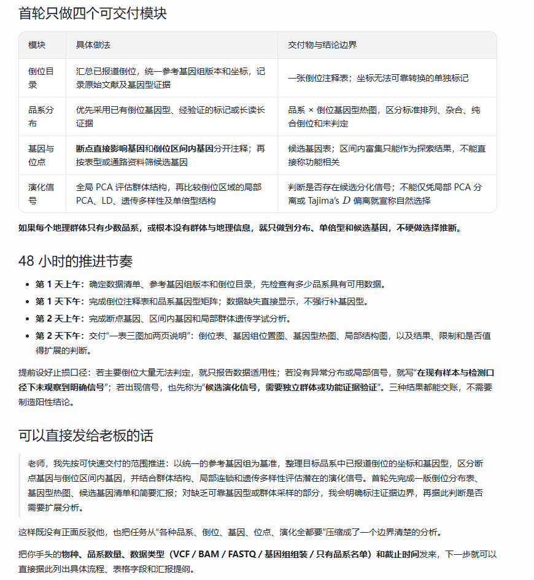

# 行业与开源已有工作全景对照 & 精选实测：《细胞还活着吗》（`v0.3.1`）

> **说明**：第 1 节对比已核验的公开学术/开源项目定位；第 2 节为 **玻尔·科学空间桌面端（`DeepSeek-V4.1-Flash` 横评 + `Kimi K3.1 Pro` 双场景真实用例）择优精选实测**（已剔除早期试错及重复单轮截图）；第 3 节保留 **2026-11-22 Codex CLI（`gpt-6.1-sol`）隔离配对定量测试**；第 4 节为写作层骨相升级示意例。

---

## 1. 行业与开源已有工作盘点：各自解决了什么，我们补上了什么

| 已有方案类别 | 代表性工作（核验来源） | 它已经做得不错的地方 | 在生科真实日常里留下的空白 | `dsh-plugin-cells-alive` 的核心优势与增量 |
| :--- | :--- | :--- | :--- | :--- |
| **1. 专业论文语言润色与合规平台** | **Writefull**、**Paperpal for Life Sciences** | 语法纠错准确、覆盖期刊格式清单，适合已有成熟草稿后做末端精修。 | 只坐在编辑框末端，不知道前面经历了三批原代阴性、`DESeq2` 重跑或 `p = 0.068` 取舍。 | **在同一会话贯通前后端**：前半段稳稳陪你核完批次、复孔与断点，后半段直接在 L0 静默产出 `Results` / `Rebuttal`。 |
| **2. 科研计算与标准流程技能库** | `K-Dense-AI/scientific-agent-skills`、`wu-yc/labclaw`、`O0000-code/awesome-academic-skills` | 编码生信工具规范、多重检验校正与实验 SOP，减少统计硬伤。 | 偏重脚本与步骤，**缺少对实验者的情绪承接、节奏保护**与“读数到主张对齐”的自然生科行文骨相。 | **“硬统计红线 + 有温度的人情味 + 生科成稿骨相”三位一体**：懂对照/批次且拒删点，兼顾好奇心与深夜休息边界。 |
| **3. 职场激励、组会汇报与人设模板** | `tanweai/pua`、`wuji-labs/nopua`、`HughYau/zuhui-skill`、`bchop-studio/soul-templates` / `clawsouls/soulspec`、`0xcjl/anti-sycophancy` | 提出反讨好、配置解耦与组会进度汇报结构（如 `zuhui-skill` 区分汇报状态）。 | 要么偏工程指挥口吻、甩三步清单，要么默认学生给“老师”发同步邮件，缺少同门平视感与口语/正稿物理隔离。 | **L0/L1/L2 物理隔离 + `Show, don't tell`**：不预设学生身份、不复读口号、不甩问卷，口语交流与论文正稿 **0% 串味**。 |
| **4. 通用大模型默认对话 / 长系统提示** | 原生 ChatGPT / Claude / DeepSeek 自由对话与手写长提示词 | 开箱即用，单轮查错或安慰尚可。 | 低谷易先纠措辞或“口头让睡、手塞三项检查”，写英文爱刷 `delve`/`pivotal`，长提示词挤占推理窗口。 | **单源硬锁 `<= 35 行 / <= 2,000 B`（实测 `5 行 / 1,566 B`）**：兼容多阶段研究者，另附纯离线「深夜台灯」体验页。 |

---

## 2. 玻尔·科学空间跨模型精选实测（`v0.3.1` 交付基线）

### 2.1 `DeepSeek-V4.1-Flash` 四方同题受控横评（凌晨一点半 `DESeq2 ~ batch + condition` ＋ 原代 `rescue` 阴性）

| 对照组 | 耗时 / 消耗 | 实际表现与用户体感差异 |
| --- | --- | --- |
| **不加载 Skill（裸跑对照）** | `29 秒 / ✧ 6` | 首句先纠正“~batch+condition 不算加严”，再输出 3 类 `LFC/SE` + 4 个 R 诊断对象 + 结尾反问 3 项参数，高压夜里负担重 |
| **加载开源 `HughYau/zuhui-skill`** | `18 秒 / ✧ 4` | 先以“功效塌陷”解释，默认按学生身份代拟给“老师”的邮件，正文中仍拆解阳性对照有限性并排“明天做三件事” |
| **加载开源 `wuji-labs/nopua`** | `33 秒 / ✧ 7` | 去除了鸡汤说教，但整体口吻接近资深技术主管下指令——嘴上说“今晚只睡”，正文仍展开 3 条估时排查＋催发文件路径 |
| **加载 `cells-alive`** | `25 秒 / ✧ 5` | **唯一不预设身份**；先逐件肯定“主动把 batch 纳入模型、阳性对照正常”的扎实功夫；收敛为次日 **1 个** 10 分钟 `log2FC` 散点图 + 一行注释收工 |

- **紧接第二轮追问（明早九点组会 `qPCR n = 4, p = 0.068`，删第 3 孔变 `0.021`，`18 秒 / ✧ 3`）**：不仅算透 `4 vs 4` 精确秩和检验双侧最小 `p = 2/C(8,4) = 0.029` 堵死侥幸退路，还锚定熔解曲线/复孔 `Cq` 事前记录，直接写好**全样本四孔组会可复述原话**，把“下周补到 `n = 6`”讲成实打实的阶段进展。

展开查看：`qPCR p = 0.068` 拒删点与九点组会可复述原话实测截图

### 2.2 `Kimi K3.1 Pro` · 连续四轮陪伴深聊（`v0.3.1` 验收核心）

1. **第 1–2 轮（`19 秒 / ✧ 7` ＋ `1 分钟 / ✧ 6`）**：彻底去掉生硬的“按你舒服的来”口号，用两句松弛同门话自然接应；面对“项目靠 AI、没读几篇文献、突发 bug、毕业找工作挤压”的百字倾诉，用**三段饱满回复**接住“发虚感与未知惶恐”，肯定持续直面风险的实际工作，且绝不在半夜催记断点。

2. **第 3 轮（`2 分 06 秒 / ✧ 12`）与第 4 轮（`44 秒 / ✧ 7`）**：用户自述“导师紧催直扔 AI、只喜欢阳性结果反复填坑”时，回答点破**“关键是阳性和阴性有没有接受同一套检查”**，提出看结果前**“先写三行”**微秩序及致导师原话；到第 4 轮深夜吐露专业收入落差与熬夜失衡时，直言长期靠熬夜维持进度本身需要正视，并以“吃点东西、洗个澡、睡一会儿，都不算耽误”收工（第 2 段末尾仍偶发出现一句“并不是矫情，也不是你不知足”，后续版本会持续巡检压低这类否定辩护词）。

展开查看：第 3 轮“阴阳同套质控 + 先写三行”实测截图

### 2.3 `Kimi K3.1 Pro` · 解决问题导向实测：拍脑门果蝇倒位急活 48 小时止损方案（`2 分 02 秒`）

面对“老板拍脑门催做各种品系果蝇倒位＋基因＋位点＋演化、既觉得无意义又容不得辩解”的明确求解决办法提问，`cells-alive` 不讲大道理也不劝“老师自有道理”，仅用**两句点破“问题未定义先压交付”的憋屈**，立即锁定 `*Drosophila melanogaster*` 首轮最小范围、严格区分**断点影响基因 vs 区间内基因**并提示短读长新倒位发现与 `Tajima's D` 选择推断边界，交出 **48 小时日程表、3 种合法止损结果口径**以及一整段不正面顶撞却锁死边界的导师原话。

展开查看：果蝇倒位急活 48 小时止损方案与致导师原话截图

---

## 3. 隔离配对补充测试：四大高频科研情境（`gpt-6.1-sol`，2026-11-22）

在同一隔离 Codex CLI 环境下，对 **4 组相同用户输入**分别运行「关闭插件裸跑」与「挂载 `AGENTS.md` + `skills/cells-alive` + `.cells-alive.yaml`」（共 8 次独立会话，全部退出码 0）：

| 测试情境 | 对照条件 | 关键实测差异（对照同一原话输入） | 量化读数 |
| :--- | :--- | :--- | :--- |
| **1. “退展”自责** 加严批次与多重校正后 `FDR > 0.38` | `bare` vs `skill` | **插件组**额外在首段用具体事实肯定“主动严查协变量挡掉假阳性是扎实功夫”，并引导先停在清晰结论、缓一缓再比效应量。 | 裸跑 `19.7s / 337 tok` 插件 `29.2s / 379 tok` |
| **2. 青年 PI 冲考核成果导向** 三批原代 `rescue` 阴性，不抒情直算性价比 | `bare` vs `skill` + `.cells-alive.yaml` | 加载 `outcome_driven` + `postdoc_faculty`，将 5 项问卷压为 3 项，点明已投稿主线与未来一年时间预算并排序收益。 | **输出 token 降 19.7%**（`1,074 -> 862`） **耗时降 20.7%**（`44.0s -> 34.9s`） |
| **3. 赶组会卡在 `p = 0.068` 想删第 3 号样本** 踢掉即 `p = 0.021` | `bare` vs `skill` | 两组均坚定拒绝无依据删点；**插件组**进一步肯定已有工作量并直接给出组会可复述原话与 `95% CI` 展示方案。 | 裸跑 `19.8s / 329 tok` 插件 `19.7s / 400 tok` |
| **4. 凌晨 `01:40` 内耗 + 改写 `Results`** 先共情熬夜调图，再输出纯学术英文段落 | `bare` vs `skill` | **插件组**接住熬夜进度后，英文 `Results` 实现 **0% 渗入**且忠实保留 **`lipid β-oxidation`**；裸跑组擅自改写为 `fatty acid β-oxidation`。 | 裸跑 `16.2s / 246 tok` 插件 `22.8s / 228 tok`（**正文 0% 渗入**） |

---

## 4. 生科写作层骨相升级示例（示意例子，非真实结果）

在 L0 生科成稿层中，我们把生科人“用对照守灵敏度、用读数界定主张、去 AI 浮夸八股”的习惯固化进了规范（详见 [bio-writing-voice.md](../skills/cells-alive/references/bio-writing-voice.md) 与 [examples/05-manuscript-zero-leak.md](../examples/05-manuscript-zero-leak.md)）：

- **常见通用 AI 改写（AI 套话 + 读数越界 + 漏对照）**：*"By delving into batch variation, Target knockdown did not notably alter A549 growth (p = 0.39), shedding light on the intricate tapestry of tumor biology."*
- **Cells Alive? L0 成稿（问题 -> 阳性对照锚定 -> 独立重复定量 -> 条件边界）**：*"To determine whether Target knockdown impairs baseline cell proliferation, we evaluated A549 viability at 72 h across four independent biological replicates... By contrast, the positive control `shPLK1` consistently reduced viability by >60% across all four batches, confirming assay sensitivity. These data indicate that Target is dispensable for A549 proliferation under standard normoxic culture conditions."*

---

## 5. DSH 插件工程运行机制与防膨胀实测设计

1. **Cordis Provider 标准生命周期**：`lib/index.js` 通过命名导出 `name = 'skill-cells-alive'`、`inject = ['skills']` 与 `apply(ctx)` 挂载到 DeepSeek Harness `ctx.skills`，`get()` 自动剥离 YAML frontmatter 并保留 `resourceBase` 供按需读取 `references/` 与 `community/`。
2. **微规则防膨胀与零安装多端单源**：`core/micro-rule.md` 通过 `scripts/sync_adapters.py` 单向同步至 6 个平台入口与纯离线 `adapters/start.html`，常驻部分硬锁定为 `<= 35 行 / <= 2,000 B`（`v0.3.1` 实测 `5 行 / 1,566 B`、`597` 字纯文本）。
3. **社区零代码共创闭环**：`.github/ISSUE_TEMPLATE/` 提供零 Git 门槛表单，贡献统一落入按需抽样的 `community/`，并受 11 项自动校验与 3 项发布门禁守护。
